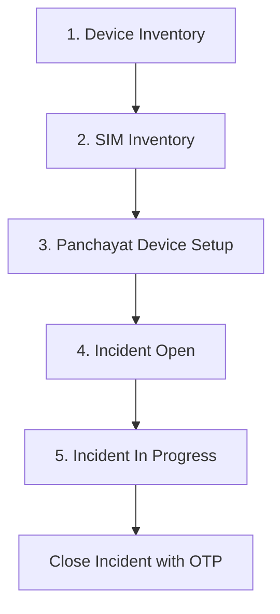
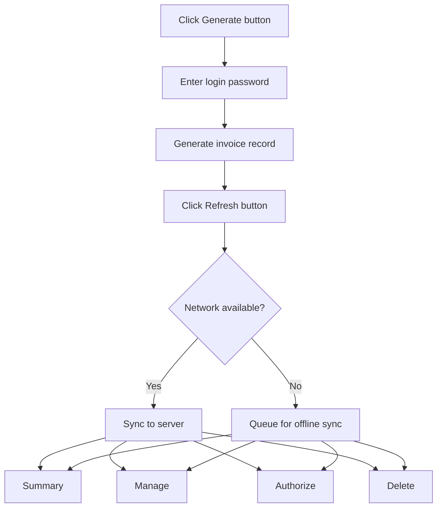

# Device Manager Documentation

## 1. Project Overview

Device Manager is a static HTML-based process flow application for managing and tracking field devices, SIM inventory, Panchayat assignments, and device incidents.

The project currently contains a visual workflow page and an invoice synchronization flow diagram. It does not include a backend, database, authentication implementation, or JavaScript business logic yet.

## 2. Project Structure

```text
Device-Manager/
|-- DEVICE_MANAGER_DOCUMENTATION.md
`-- device manager/
    |-- index.html
    `-- Invoice /
        `-- invoice.md
```

| Path | Description |
|---|---|
| `device manager/index.html` | Main Device Manager process-flow webpage |
| `device manager/Invoice /invoice.md` | Mermaid invoice generation and synchronization flow |

## 3. Main Workflow

The main workflow is shown as a vertical, five-step process.



### Step 1: Device Inventory Creating

The system records a device and displays its initial stock state.

- Enter the device serial number.
- Scan a device barcode.
- Mark the device as `SMDM Pending to Stock`.

Expected future fields:

- Device serial number
- Barcode
- Device model
- Device condition
- Stock status
- Created date

### Step 2: SIM Inventory Creating

The system creates and registers a SIM inventory record.

- Create the SIM serial number.
- Register the SIM status.

Expected future fields:

- SIM serial number / ICCID
- Mobile number
- Network provider
- SIM status
- Assigned device

### Step 3: Panchayat Device Setup

The device is prepared for use in a Panchayat.

- Install the Admin App.
- Configure required permissions.
- Assign the device to a Panchayat Secretary.
- Generate property-inspection data.

### Step 4: Device Incident - Open

A technician or administrator creates an incident when a device problem occurs.

- Incident status: `Open`

The incident should contain:

- Incident ID
- Device serial number
- Reporter
- Panchayat / assigned location
- Problem description
- Created date and time
- Current status

### Step 5: Device Incident - Resolution

The incident is processed until it is closed.

Supported statuses in the visual design:

- `Inprogress`
- `Close`
- `OTP`

Before closing an incident, the system should verify the OTP and record the resolution details.

## 4. Invoice and Synchronization Workflow

The invoice flow is documented in `device manager/Invoice /invoice.md`.



The flow uses an online/offline synchronization model:

1. The user selects Generate.
2. The user enters a login password.
3. An invoice record is created locally.
4. The user selects Refresh.
5. If the network is available, the invoice is sent to the server.
6. If the network is unavailable, the invoice remains queued for later synchronization.
7. The invoice can be viewed in Summary or processed using Manage, Authorize, or Delete actions.

## 5. UI and Technical Details

### Technologies

- HTML5
- CSS3
- Google Fonts (`Poppins`)
- Inline SVG arrows
- Mermaid diagram syntax

### Features in the Current HTML

- Responsive page container
- Vertical process flow
- Step badges
- Gradient node colors
- SVG connectors
- Print-friendly CSS
- Basic mobile layout
- Status headings using red and pink background colors

### Printing

The page contains print-specific styles that:

- Change the page background to white.
- Retain node print colors.
- Remove the footer.
- Remove node box shadows.

## 6. Running the Project

From the repository root:

```bash
cd "device manager"
python3 -m http.server 8080
```

Open:

```text
http://localhost:8080
```

## 7. Color and Status Mapping

| Step | Display class | Color theme |
|---|---|---|
| 1 | `step-1` | Cyan to blue |
| 2 | `step-2` | Teal to green |
| 3 | `step-3` | Amber to red |
| 4 and 5 | `step-4` | Purple to indigo |
| 6, if future extension | `step-6` | Teal to cyan |

## 8. Current Limitations

The following items are required for a functional production application but are not implemented in the current repository:

- No device or SIM CRUD operations
- No backend API
- No database
- No login or session implementation
- No barcode-scanner integration
- No real invoice storage
- No server synchronization
- No offline queue implementation
- No incident lifecycle state storage
- No OTP validation
- No role-based access control
- No form validation
- No search, pagination, or export functionality
- No automated tests

## 9. Recommended API Modules

The project can be extended with the following modules:

### Device API

```text
POST   /api/devices
GET    /api/devices
GET    /api/devices/{serialNumber}
PUT    /api/devices/{serialNumber}
DELETE /api/devices/{serialNumber}
```

### SIM API

```text
POST /api/sims
GET  /api/sims
PUT  /api/sims/{iccid}
```

### Incident API

```text
POST /api/incidents
GET  /api/incidents
PUT  /api/incidents/{incidentId}/status
POST /api/incidents/{incidentId}/verify-otp
```

### Invoice API

```text
POST /api/invoices
GET  /api/invoices/{invoiceId}
POST /api/invoices/{invoiceId}/authorize
POST /api/invoices/{invoiceId}/sync
DELETE /api/invoices/{invoiceId}
```

## 10. Recommended Data Models

### Device

| Field | Type | Description |
|---|---|---|
| `id` | string | Internal unique identifier |
| `serialNumber` | string | Device serial number |
| `barcode` | string | Scannable device identifier |
| `model` | string | Device model |
| `status` | string | Stock or assigned status |
| `assignedTo` | string | Panchayat Secretary or department |

### SIM

| Field | Type | Description |
|---|---|---|
| `id` | string | Internal unique identifier |
| `iccid` | string | SIM serial number |
| `phoneNumber` | string | Registered mobile number |
| `provider` | string | Network provider |
| `status` | string | Active, inactive, or assigned |

### Incident

| Field | Type | Description |
|---|---|---|
| `id` | string | Internal incident identifier |
| `deviceSerialNumber` | string | Affected device |
| `description` | string | Problem details |
| `status` | string | Open, In Progress, or Closed |
| `otpVerified` | boolean | Whether closure OTP was verified |
| `createdAt` | datetime | Incident creation time |
| `closedAt` | datetime | Incident closure time |

## 11. Improvement Recommendations

1. Replace typo-heavy labels with standard, consistent terminology.
2. Convert the static flow into accessible HTML forms.
3. Add unique incident and invoice identifiers.
4. Add role-based authentication.
5. Store records in a database.
6. Integrate a barcode and QR scanner.
7. Implement OTP verification for secure incident closure.
8. Add online/offline synchronization with a local queue.
9. Add automated unit and browser tests.
10. Move inline styles and duplicate CSS into reusable CSS classes.
11. Add error, loading, empty, and success states.
12. Add an audit trail for device assignments and incident status changes.
